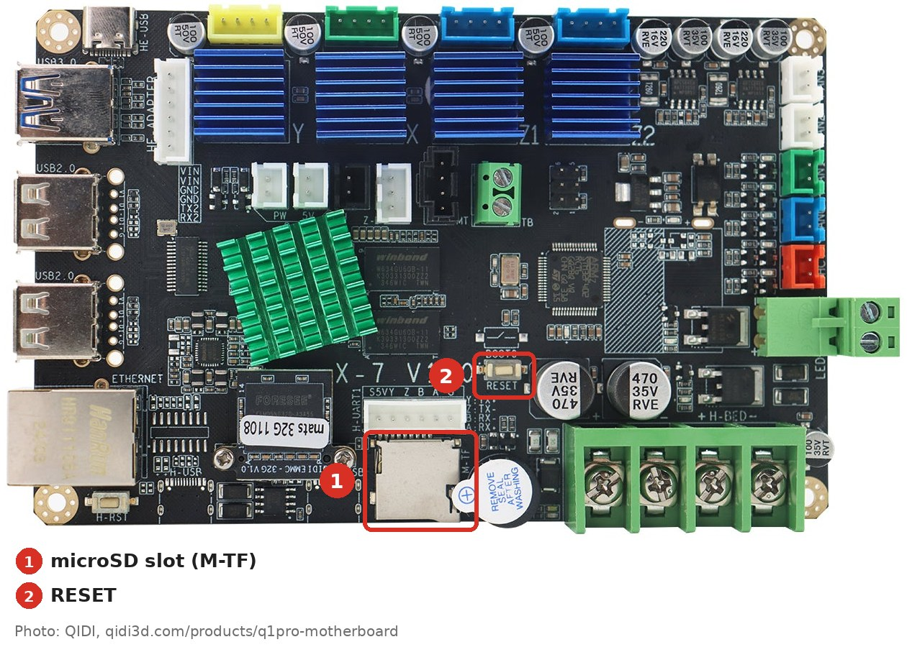
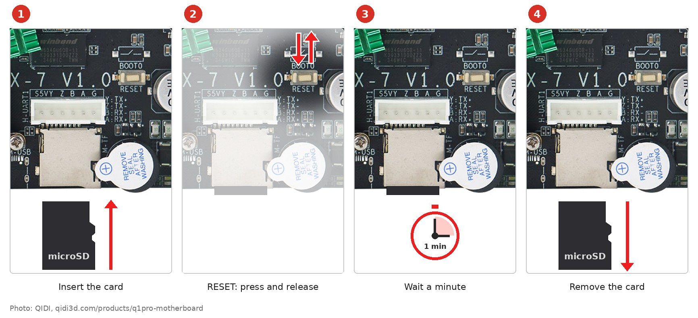
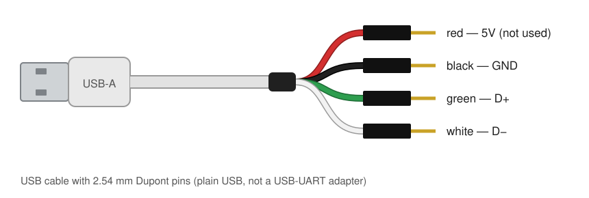
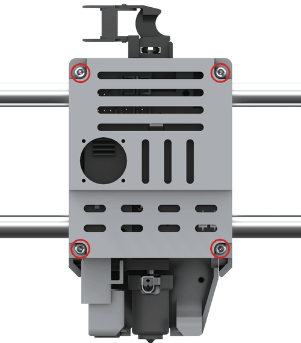
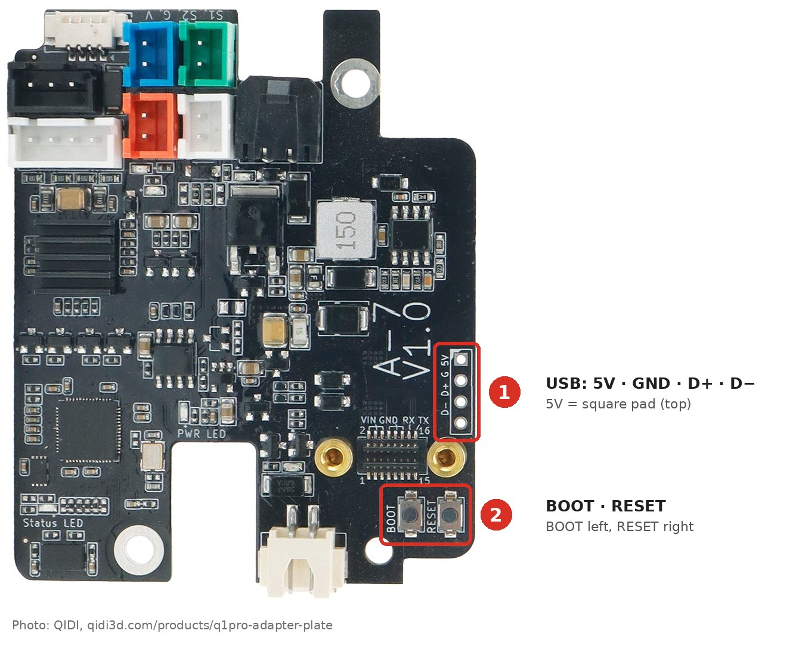
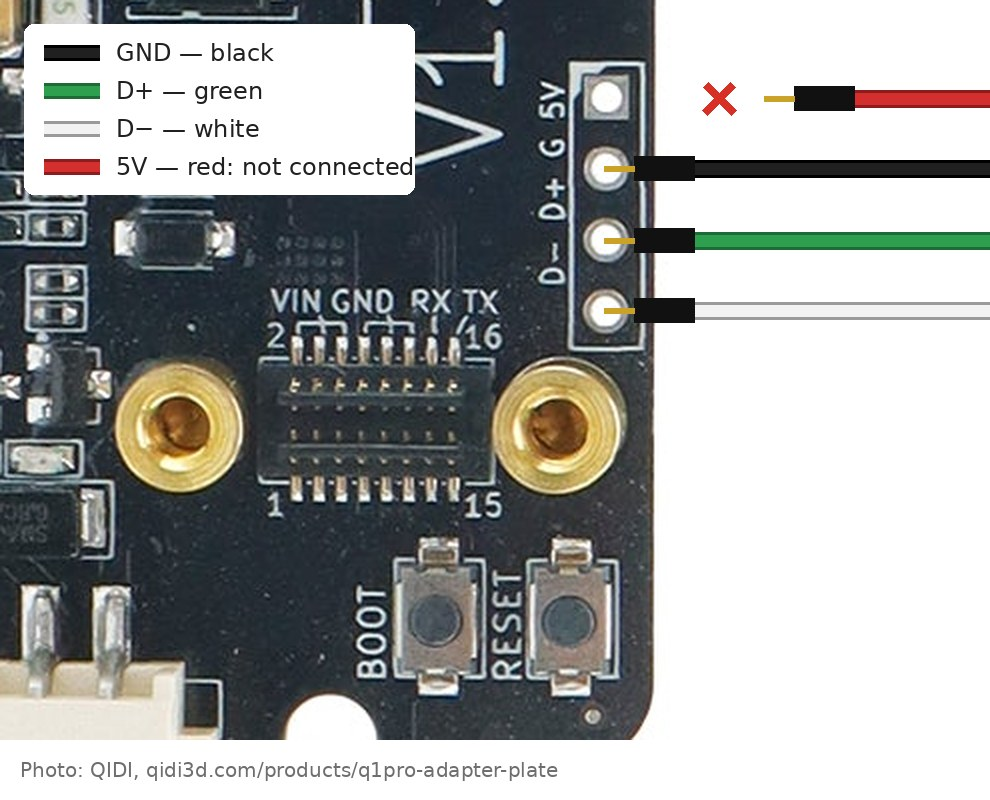
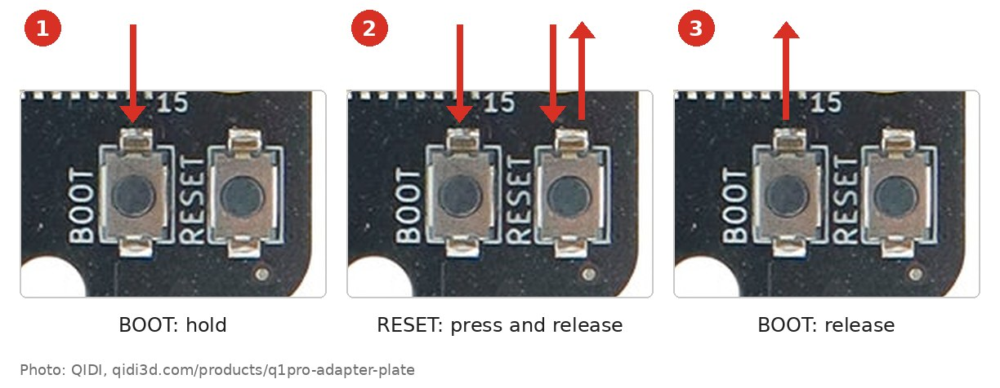

# QIDI Q1 Pro: Katapult and Klipper MCU firmware

[Русский](README.ru.md)

[Katapult](https://github.com/LibreQ1Pro/katapult) and [Klipper](https://github.com/LibreQ1Pro/klipper) for both boards of
the QIDI Q1 Pro: the mainboard (STM32F401) and the toolhead (RP2040), built from
source. To go back to QIDI's firmware use
[QIDI_Q1_Pro-Stock-Firmware](https://github.com/LibreQ1Pro/QIDI_Q1_Pro-Stock-Firmware).

The sources are pinned in `SOURCES` (the forks
[LibreQ1Pro/klipper](https://github.com/LibreQ1Pro/klipper) and
[LibreQ1Pro/katapult](https://github.com/LibreQ1Pro/katapult)); the settings are
in [QIDI_Q1_Pro-Config](https://github.com/LibreQ1Pro/QIDI_Q1_Pro-Config)
(`firmware/klipper/` and `firmware/katapult/`), also pinned in `SOURCES`.
`firmware/BUILD-INFO` has the commits and the compiler of the
images.

## Files in `firmware/`

| File | Board | What |
|---|---|---|
| `katapult/qd_mcu.bin` | mainboard | Katapult at `0x08008000`, after QIDI's 32 KiB bootloader, which stays untouched |
| `katapult/toolhead-katapult.uf2` | toolhead | Katapult at `0x10000100` |
| `katapult/toolhead-katapult.withclear.uf2` | toolhead | the same, and it clears the start of the application area (`0x10004000`), so Katapult stays active until a new Klipper is uploaded |
| `klipper/katapult/mainboard-klipper.bin` | mainboard | Klipper at `0x0800C000`, started by Katapult |
| `klipper/katapult/toolhead-klipper.bin` | toolhead | Klipper at `0x10004000`, started by Katapult |
| `klipper/standalone/qd_mcu.bin` | mainboard | Klipper at `0x08008000` without Katapult |
| `klipper/standalone/toolhead-klipper.uf2` | toolhead | Klipper without Katapult |
| `display/display.tft` | screen | [LibreScreen](https://github.com/LibreQ1Pro/LibreScreen) firmware of the 480x272 TJC screen, compiled in USART HMI from `librescreen/display_firmware` |

`qd_mcu.bin` is the name QIDI's bootloader reads from the microSD card, so
these two files can be copied to the card as they are.

## Flashing

On the printer, `flash.sh` flashes Klipper through Katapult and the screen for you.
Katapult has to be installed first, see [Installing Katapult](#installing-katapult):

```sh
./flash.sh mainboard      # klipper/katapult/mainboard-klipper.bin to /dev/ttyS0 through Katapult
./flash.sh toolhead       # klipper/katapult/toolhead-klipper.bin to /dev/ttyS2 through Katapult
./flash.sh display        # display/display.tft with ~/LibreScreen/main.py --flash-screen
./flash.sh mainboard -n   # only prints the commands
```

It asks Moonraker and refuses to flash while a print is running or paused, or while
Klipper runs but Moonraker gives no usable answer (`-f` flashes anyway). It stops Klipper while it flashes a board, LibreScreen while it flashes the
screen, and starts it again at the end.
After flashing the screen,
power-cycle the printer if the transfer was interrupted.

Without Katapult: `klipper/standalone/qd_mcu.bin` goes to the microSD card of the
mainboard, `klipper/standalone/toolhead-klipper.uf2` to the BOOTSEL drive of the
toolhead.

The screen: run `./flash.sh display`. The host and the `.tft` must be the same
LibreScreen version.

## Installing Katapult

This is done once per board. It puts **Katapult** (a bootloader) on the board;
Klipper itself is then flashed with `./flash.sh` (see [Flashing](#flashing)),
without the microSD card and the USB cable. The two sections below are only
about getting Katapult onto the board.

## Mainboard: `katapult/qd_mcu.bin`

You need a microSD card formatted as FAT32. Copy `katapult/qd_mcu.bin` to the
root of the card. Do not rename the file.

The mainboard has a microSD slot (marked 1) and the RESET button of the MCU
above it (marked 2).



With the printer on:

1. Insert the card into the slot.
2. Press and release RESET. The MCU restarts and flashes the file from the card.
3. Wait a minute.
4. Remove the card. The printer does not need to be turned off.
5. Katapult is on the mainboard now. Flash Klipper with `./flash.sh mainboard`.



## Toolhead: `katapult/toolhead-katapult.withclear.uf2`

You need:

* a USB cable with 2.54 mm Dupont pins on the other end. It is a plain USB
  cable, not a USB-UART adapter. A charge-only cable (red and black wires only)
  will not work;
* a zip tie;
* a computer.



### 1. Remove the toolhead back cover

Turn the printer off. Remove the 4 screws of the toolhead back cover and take
the cover off.



### 2. Connect the cable

On the right edge of the toolhead board there are 4 holes for USB (marked 1)
and the BOOT and RESET buttons below them (marked 2).



Insert the pins into the holes, top to bottom:

* **5V** (square pad, top): nothing. Leave the red wire unconnected.
* **GND**: black.
* **D+**: green.
* **D−**: white.



The holes do not hold the pins. Tie the wires together with a zip tie so that
each one is slightly tensioned and its pin presses against the hole.

### 3. Put the toolhead into USB mode

1. Plug the USB end into the computer.
2. Turn the printer on.
3. Hold BOOT, press and release RESET, release BOOT.



The computer shows a new drive called `RPI-RP2`.

### 4. Flash

Copy `katapult/toolhead-katapult.withclear.uf2` to the `RPI-RP2` drive. The
drive disappears by itself when the copy is complete, and the toolhead starts
Katapult.

Use the `withclear` file: the plain `toolhead-katapult.uf2` leaves the old
firmware in place, and Katapult would start it at once.

Turn the printer off, disconnect the cable and put the cover back. Then turn the
printer on and flash Klipper with `./flash.sh toolhead`.

### If `RPI-RP2` does not show up

* Swap the green and white wires: the colors of some cables do not match the
  standard.
* Check that every pin presses against its hole. Pull the zip tie tighter.
* Repeat the BOOT and RESET sequence. You can also hold BOOT while turning the
  printer on.
* Try another cable: it must have 4 wires.

## Image credits

* The board pictures are QIDI's product photos of the toolhead board
  (https://qidi3d.com/products/q1pro-adapter-plate) and the mainboard
  (https://qidi3d.com/products/q1pro-motherboard) with our marks.
* The toolhead back cover picture (`toolhead-cover.png`) is a render of the
  "QIDI Q1 Pro Assembly CAD Model" (https://www.printables.com/model/1648049-qidi-q1-pro-assembly-cad-model).
  Its license is the one set by the
  author on that page.

## Building

On the printer (the image has the packages) or any Debian:

```sh
sudo apt install build-essential git python3 gcc-arm-none-eabi \
    binutils-arm-none-eabi libnewlib-arm-none-eabi
./build.sh        # about 5 minutes on the printer; result: firmware/
```

`build.sh` clones the two forks and the config repository into `build/`, checks
out the commits of `SOURCES`, builds each config and fails if the compiler drops an
option of the config. To build newer sources or configs, change the commits in `SOURCES`.

| Board | Klipper config | Katapult config |
|---|---|---|
| mainboard (`[mcu U_1]`) | `firmware-mainboard[-katapult].config` | `katapult-mainboard.config` |
| toolhead (`[mcu]`) | `firmware-toolhead[-katapult].config` | `katapult-toolhead.config` |

The Katapult images are the same on every machine. The Klipper images contain
the abbreviated commit hash as the version, whose length depends on the git of
the machine, so their checksums differ between machines.
