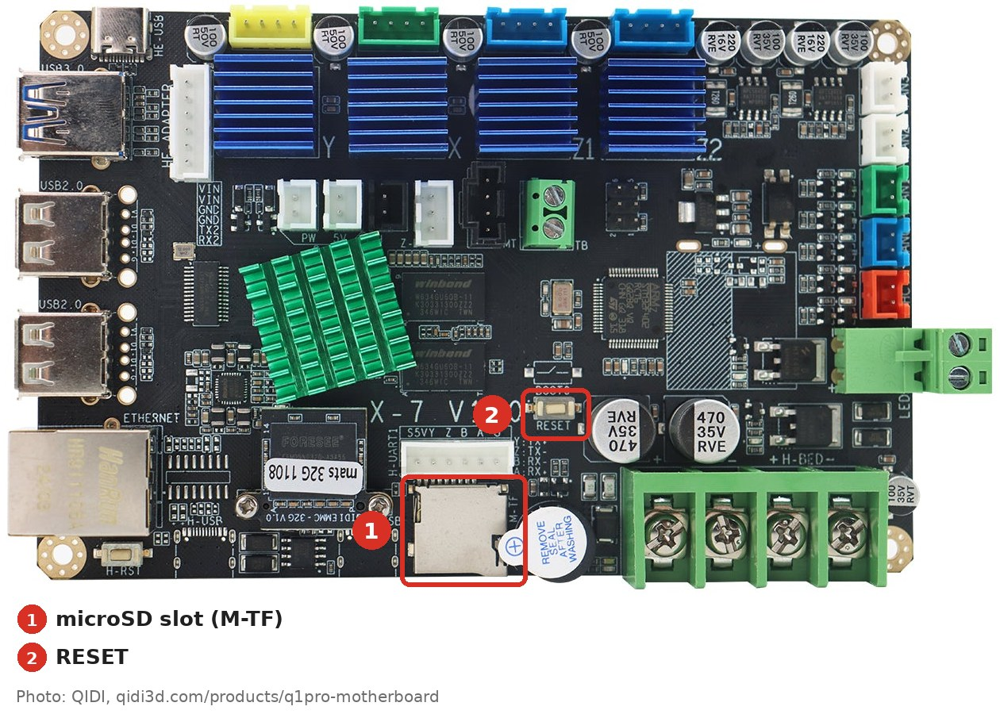
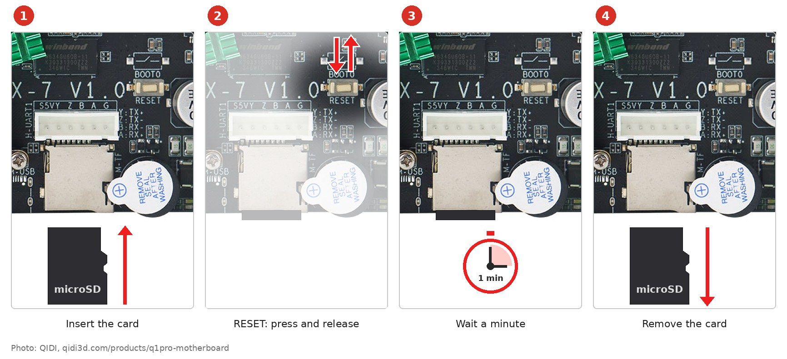
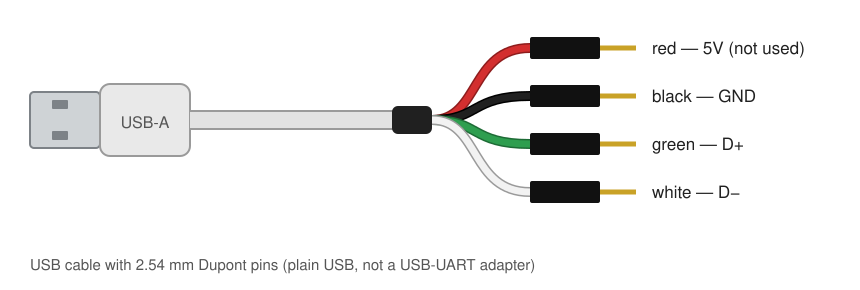
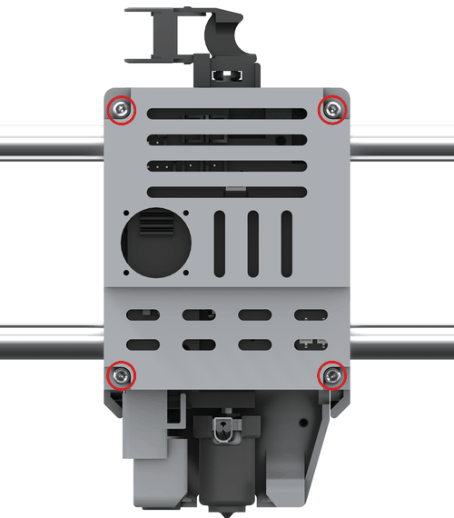
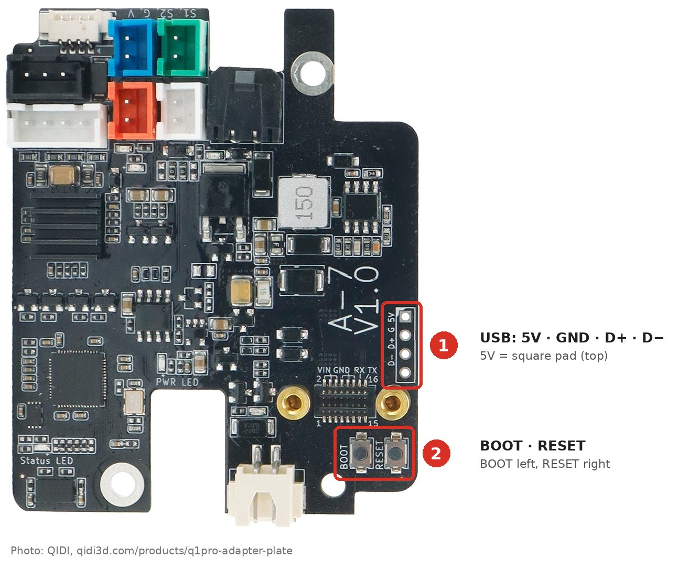
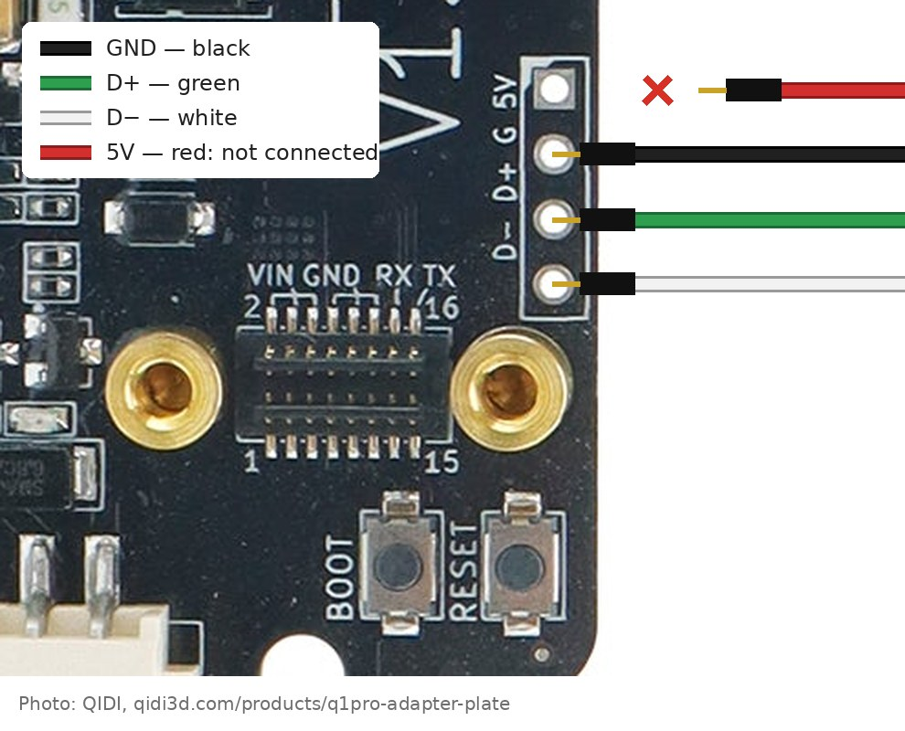
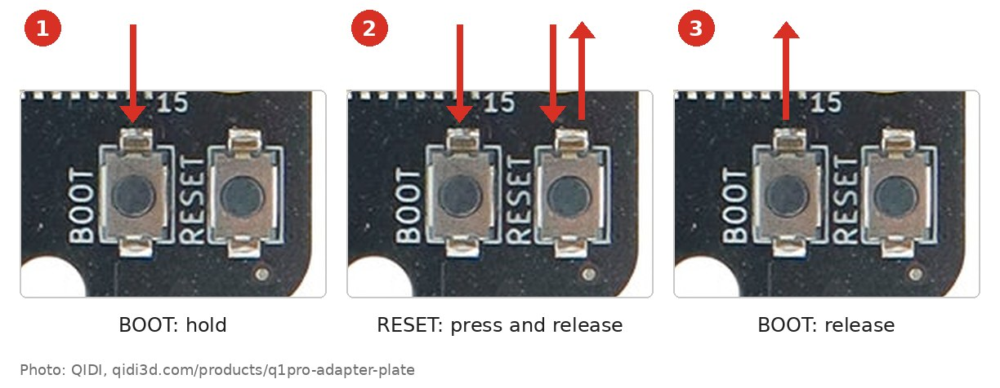

# QIDI Q1 Pro: прошивки MCU Katapult и Klipper

[English](README.md)

[Katapult](https://github.com/LibreQ1Pro/katapult) и [Klipper](https://github.com/LibreQ1Pro/klipper) для обеих плат
QIDI Q1 Pro: основной (STM32F401) и головы (RP2040), собранные из исходников.
Чтобы вернуться на прошивку QIDI, используйте
[QIDI_Q1_Pro-Stock-Firmware](https://github.com/LibreQ1Pro/QIDI_Q1_Pro-Stock-Firmware).

Исходники закреплены в `SOURCES` (форки
[LibreQ1Pro/klipper](https://github.com/LibreQ1Pro/klipper) и
[LibreQ1Pro/katapult](https://github.com/LibreQ1Pro/katapult)); настройки лежат в
[QIDI_Q1_Pro-Config](https://github.com/LibreQ1Pro/QIDI_Q1_Pro-Config)
(`firmware/klipper/` и `firmware/katapult/`), тоже закреплены в `SOURCES`.
В `firmware/BUILD-INFO` указаны коммиты и компилятор, которыми собраны образы.

## Файлы в `firmware/`

| Файл | Плата | Что это |
|---|---|---|
| `katapult/qd_mcu.bin` | основная | Katapult по адресу `0x08008000`, после 32-КиБ бутлоадера QIDI, который остаётся нетронутым |
| `katapult/toolhead-katapult.uf2` | голова | Katapult по адресу `0x10000100` |
| `katapult/toolhead-katapult.withclear.uf2` | голова | то же, плюс очищает начало области приложения (`0x10004000`), поэтому Katapult остаётся активным, пока не загружен новый Klipper |
| `klipper/katapult/mainboard-klipper.bin` | основная | Klipper по адресу `0x0800C000`, запускается из Katapult |
| `klipper/katapult/toolhead-klipper.bin` | голова | Klipper по адресу `0x10004000`, запускается из Katapult |
| `klipper/standalone/qd_mcu.bin` | основная | Klipper по адресу `0x08008000` без Katapult |
| `klipper/standalone/toolhead-klipper.uf2` | голова | Klipper без Katapult |
| `display/display.tft` | экран | прошивка [LibreScreen](https://github.com/LibreQ1Pro/LibreScreen) для экрана TJC 480x272, скомпилирована в USART HMI из `librescreen/display_firmware` |

`qd_mcu.bin` — имя, которое бутлоадер QIDI читает с microSD, поэтому эти два
файла можно копировать на карту как есть.

## Прошивка

На принтере `flash.sh` прошивает Klipper через Katapult и экран.
Katapult должен быть установлен заранее, см. [Установка Katapult](#установка-katapult):

```sh
./flash.sh mainboard      # klipper/katapult/mainboard-klipper.bin на /dev/ttyS0 через Katapult
./flash.sh toolhead       # klipper/katapult/toolhead-klipper.bin на /dev/ttyS2 через Katapult
./flash.sh display        # display/display.tft через ~/LibreScreen/main.py --flash-screen
./flash.sh mainboard -n   # только вывести команды
```

Скрипт спрашивает Moonraker и отказывается прошивать, пока идёт или поставлена
на паузу печать, либо пока Klipper работает, а Moonraker не даёт внятного ответа
(`-f` прошьёт всё равно). На время прошивки платы он останавливает Klipper, на
время прошивки экрана — LibreScreen, и в конце запускает их снова.
После прошивки экрана выключите и включите принтер, если передача была прервана.

Без Katapult: `klipper/standalone/qd_mcu.bin` кладётся на microSD основной
платы, `klipper/standalone/toolhead-klipper.uf2` — на диск BOOTSEL головы.

Экран: запустите `./flash.sh display`. Хост и `.tft` должны быть одной версии
LibreScreen.

## Установка Katapult

Делается один раз для каждой платы. На плату ставится **Katapult** (загрузчик);
сам Klipper потом прошивается через `./flash.sh` (см. [Прошивка](#прошивка)),
без карты microSD и USB-кабеля. Два раздела ниже только о том, как поставить
Katapult на плату.

## Основная плата: `katapult/qd_mcu.bin`

Нужна microSD-карта в FAT32. Скопировать на неё `katapult/qd_mcu.bin` в корень.
Файл не переименовывать.

На основной плате есть слот microSD (отмечен цифрой 1) и над ним кнопка RESET
микроконтроллера (отмечена цифрой 2).



На включённом принтере:

1. Вставить карту в слот.
2. Нажать и отпустить RESET. Микроконтроллер перезапустится и прошьёт файл с карты.
3. Подождать минуту.
4. Вынуть карту. Выключать принтер не нужно.
5. Katapult на основной плате установлен. Прошить Klipper командой `./flash.sh mainboard`.



## Голова: `katapult/toolhead-katapult.withclear.uf2`

Понадобится:

* USB-кабель с разъёмами Dupont 2,54 мм на другом конце. Обычный USB, не
  USB-UART адаптер. Кабель только для зарядки (только красный и чёрный провода)
  не подойдёт;
* стяжка;
* компьютер.



### 1. Снять заднюю крышку головы

Выключить принтер. Открутить 4 винта задней крышки головы и снять её.



### 2. Подключить кабель

На правом краю платы головы есть 4 отверстия для USB (отмечены цифрой 1), под
ними кнопки BOOT и RESET (отмечены цифрой 2).



Вставить пины в отверстия, сверху вниз:

* **5V** (квадратная площадка, сверху): ничего. Красный провод не подключать.
* **GND**: чёрный.
* **D+**: зелёный.
* **D−**: белый.



Отверстия пины не держат. Стянуть провода стяжкой так, чтобы каждый был слегка
натянут и его пин прижимался к отверстию.

### 3. Перевести голову в режим USB

1. Вставить USB в компьютер.
2. Включить принтер.
3. Зажать BOOT, нажать и отпустить RESET, отпустить BOOT.



На компьютере появится новый диск `RPI-RP2`.

### 4. Прошить

Скопировать `katapult/toolhead-katapult.withclear.uf2` на диск `RPI-RP2`. Когда
копирование закончится, диск сам пропадёт, а голова запустит Katapult.

Нужен именно файл `withclear`: обычный `toolhead-katapult.uf2` оставляет на
месте старую прошивку, и Katapult сразу запустил бы её.

Выключить принтер, отключить кабель, поставить крышку на место. Затем включить
принтер и прошить Klipper командой `./flash.sh toolhead`.

### Если `RPI-RP2` не появляется

* Поменять местами зелёный и белый провода: у некоторых кабелей цвета не
  совпадают со стандартом.
* Проверить, что каждый пин прижат к своему отверстию. Затянуть стяжку сильнее.
* Повторить BOOT и RESET. Ещё можно держать BOOT при включении принтера.
* Попробовать другой кабель: в нём должно быть 4 провода.

## Источники изображений

* Картинки плат — фото товаров QIDI: плата головы
  (https://qidi3d.com/products/q1pro-adapter-plate) и основная плата
  (https://qidi3d.com/products/q1pro-motherboard), с нашими пометками.
* Картинка задней крышки головы (`toolhead-cover.png`) — рендер модели
  «QIDI Q1 Pro Assembly CAD Model» (https://www.printables.com/model/1648049-qidi-q1-pro-assembly-cad-model).
  Лицензия — та, что указал автор на этой странице.

## Сборка

На принтере (в образе есть пакеты) или на любом Debian:

```sh
sudo apt install build-essential git python3 gcc-arm-none-eabi \
    binutils-arm-none-eabi libnewlib-arm-none-eabi
./build.sh        # около 5 минут на принтере; результат: firmware/
```

`build.sh` клонирует два форка и репозиторий с конфигами в `build/`, переключает
их на коммиты из `SOURCES`, собирает каждый конфиг и завершается ошибкой, если
компилятор отбросил опцию конфига. Чтобы собрать более новые исходники или
конфиги, поменяйте коммиты в `SOURCES`.

| Плата | Конфиг Klipper | Конфиг Katapult |
|---|---|---|
| основная (`[mcu U_1]`) | `firmware-mainboard[-katapult].config` | `katapult-mainboard.config` |
| голова (`[mcu]`) | `firmware-toolhead[-katapult].config` | `katapult-toolhead.config` |

Образы Katapult одинаковы на любой машине. В образах Klipper в качестве версии
записан сокращённый хеш коммита, длина которого зависит от git на машине, поэтому
их контрольные суммы на разных машинах отличаются.
